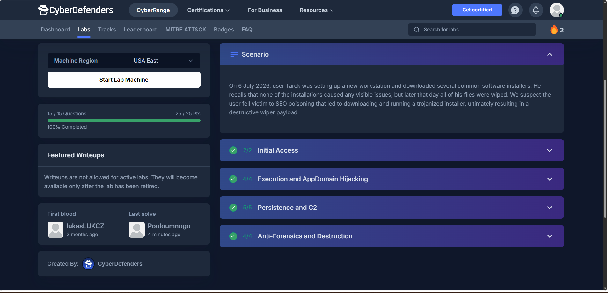

# Phantom Installer CyberDefenders Blue Team Investigation

## Project Overview

This project documents a hands-on digital forensics and incident response investigation completed through the CyberDefenders platform.

The investigation focused on analyzing suspicious Windows executable files, examining forensic artifacts, reconstructing system activity, and identifying malicious behavior.

## Investigation Objectives

- Examine suspicious executable files and related artifacts.
- Analyze Windows file system and execution evidence.
- Investigate potential command-and-control activity.
- Identify indicators of compromise.
- Reconstruct relevant events using forensic tools.
- Document technical findings and security recommendations.

## Tools Used

- FTK Imager
- Event Viewer
- Detect It Easy
- dnSpy
- MFTECmd
- Timeline Explorer
- PECmd
- PowerShell and Command Prompt

## Investigation Status

**Status:** CyberDefenders lab completed.

Detailed methodology, findings, and supporting evidence will be added in the next documentation phase.

---

## Investigation Methodology

### 1. Forensic Evidence Examination

Used FTK Imager to examine Windows forensic artifacts and identify suspicious executable files associated with the investigation.

### 2. Suspicious File Analysis

Examined executable files associated with the suspicious installer, including:

- `update.exe`
- `ZoomSetupCode.payload.update.exe`
- `byebye.exe`
- `nftec.exe`

Used Detect It Easy and dnSpy during file analysis to examine executable characteristics and investigate potentially malicious functionality.

### 3. Windows Artifact Analysis

Investigated Windows execution and filesystem artifacts using:

- MFTECmd
- Timeline Explorer
- PECmd
- Windows Event Viewer

These tools supported examination of file metadata, execution evidence, and recorded system activity.

### 4. Timeline Reconstruction

Correlated available forensic timestamps and execution artifacts to investigate the sequence of suspicious activity.

The investigation focused on identifying the relationship between the suspicious installer, subsequent executable activity, and potential command-and-control or destructive behavior.

### 5. Findings and Reporting

Documented the investigation findings, relevant indicators, and security implications.

The investigation was performed as an authorized CyberDefenders Blue Team training exercise.

## Investigation Evidence

### Lab Completion

*Evidence of completed CyberDefenders Phantom Installer investigation.*

---

## Forensic Evidence and Technical Findings

### 1. Suspicious Installer Investigation

The investigation began by examining a suspicious software installer obtained from an unofficial distribution source.

The analysis focused on:

- Identifying the downloaded executable.
- Reviewing file metadata and digital signature information.
- Examining configuration files associated with the installer.
- Investigating how a legitimate application could be abused to execute unauthorized code.

**Security Finding:** A valid digital signature does not guarantee that every component or configuration associated with an application is safe.

### 2. File Metadata Analysis

FTK Imager was used to examine suspicious executable files and their filesystem metadata.

The investigation included reviewing:

- File names and extensions.
- File sizes.
- Creation, modification, and access timestamps.
- Related executable artifacts.

These findings helped establish relationships between suspicious files and identify events requiring further investigation.

**Analyst Note:** Filesystem timestamps should be correlated with other evidence because they may be affected by file operations, system configuration, or timestamp manipulation.

### 3. Windows Execution Artifact Analysis

Windows execution artifacts were examined to determine whether suspicious programs had executed.

The investigation included analyzing execution-related records using forensic tools such as PECmd and Timeline Explorer.

The analysis focused on:

- Identifying program execution evidence.
- Reviewing execution counts where available.
- Correlating execution records with filesystem events.
- Establishing a sequence of suspicious activity.

**Security Finding:** Execution artifacts can help establish that a program was launched, but additional evidence is needed to determine its full behavior.

### 4. Filesystem Timeline Reconstruction

MFTECmd was used to process NTFS filesystem metadata and generate structured output for analysis.

The resulting dataset contained hundreds of thousands of records.

Timeline Explorer was used to review and filter these records to identify relevant filesystem events.

The investigation demonstrated how timeline analysis can help analysts reconstruct suspicious activity from large forensic datasets.

### 5. Executable and Configuration Analysis

Detect It Easy and dnSpy were used to investigate executable characteristics and managed-code behavior.

The analysis examined how application configuration and assembly-loading mechanisms could influence program execution.

The investigation also explored the security implications of application execution hijacking.

**Security Finding:** Attackers may abuse legitimate application components or configuration mechanisms to execute unauthorized code.

### 6. Persistence and Command-and-Control Analysis

The investigation examined mechanisms that could allow malicious activity to continue after initial execution.

Areas investigated included:

- Scheduled-task modification.
- Abuse of legitimate application update mechanisms.
- Suspicious executable execution.
- Embedded payload behavior.
- Potential command-and-control activity.

The findings were evaluated using available forensic artifacts and execution records.

No live command-and-control network capture is included in this report.

### 7. Anti-Forensics and Destructive Activity

The investigation examined suspicious behavior associated with attempts to interfere with recovery and forensic analysis.

Areas investigated included:

- Attempts to delete Windows volume shadow copies.
- Attempts to clear Windows event logs.
- Destructive payload behavior.
- Filesystem evidence associated with suspicious activity.

**Security Finding:** Attempts to remove recovery data or clear security logs can indicate efforts to disrupt system recovery, conceal activity, or reduce forensic visibility.

### 8. Evidence Limitations

This report summarizes investigative techniques and findings from a completed CyberDefenders training exercise.

The original investigation environment is no longer available for additional evidence collection.

The repository contains completion evidence but does not include a complete forensic evidence package.

To respect the CyberDefenders policy for active labs, challenge-specific answers, exact indicators, and detailed solution steps have been intentionally omitted.

No malicious executables, disk images, or proprietary challenge materials are distributed through this repository.

---

---

## Investigation Findings and Security Recommendations

### Investigation Summary

Completed the CyberDefenders Phantom Installer blue team investigation, achieving 100% completion (15/15 questions, 25/25 points).

The investigation involved examining suspicious Windows executables, reviewing forensic artifacts, reconstructing a filesystem timeline, and analyzing techniques associated with malicious software execution, persistence, command-and-control activity, and destructive behavior.

### Technical Skills Demonstrated

- **Digital Forensics:** Examined Windows filesystem metadata and execution artifacts.
- **Malware Analysis:** Investigated suspicious executable characteristics using Detect It Easy and dnSpy.
- **Timeline Analysis:** Used MFTECmd and Timeline Explorer to correlate filesystem events.
- **Threat Investigation:** Analyzed potential persistence mechanisms and command-and-control activity.
- **Incident Response:** Interpreted forensic findings and developed defensive recommendations.

### Security Recommendations

1. Download and install software only from trusted, verified sources.
2. Implement application allowlisting where appropriate.
3. Monitor unusual scheduled task creation and modification.
4. Collect and centralize Windows security and endpoint telemetry.
5. Investigate suspicious executable activity and unexpected outbound connections.
6. Maintain protected, tested backups and restrict unauthorized changes to recovery mechanisms.

### Evidence and Limitations

The original forensic environment is no longer available for additional evidence collection.

This repository provides a summary of the investigative methodology and skills demonstrated. Detailed challenge questions, answers, and malicious samples are intentionally excluded in accordance with CyberDefenders' active-lab writeup restrictions.

### Lab Outcome

**Status:** Completed  
**Score:** 25/25 points  
**Completion:** 100%

---
