# SigmaPredator Windows Event Log Clearing Detection Engineering

## Project Overview

This project documents a hands-on detection engineering investigation completed through the CyberDefenders SigmaPredator lab.

The investigation focuses on identifying Windows Event Log Clearing techniques associated with attacker defense evasion and developing Sigma detection rules to identify suspicious activity.

## Scenario

As a Detection and Hunting Engineer at the fictional CyberPredator Enterprise, my objective is to research adversary techniques used to clear Windows event logs, identify relevant forensic artifacts, and develop detection rules to improve security monitoring.

## Project Objectives

- Investigate Windows Event Log Clearing techniques.
- Identify relevant Windows commands, PowerShell methods, and WMI activity.
- Analyze Windows process creation and security event logs.
- Develop Sigma detection rules.
- Validate detections using Chainsaw and historical EVTX logs.
- Document findings and recommend detection improvements.

## Tools and Technologies

- Sigma
- Chainsaw
- Visual Studio Code
- Windows Event Logs
- PowerShell
- MITRE ATT&CK

## Investigation Progress

### Phase 1: Technique Research

In progress.

### Phase 2: Sigma Rule Development and Validation

Not started.

## Evidence and Screenshots

Screenshots and detection results will be added throughout the investigation.

## Key Findings

To be completed after validating the detection rules.


## Lab Scenario

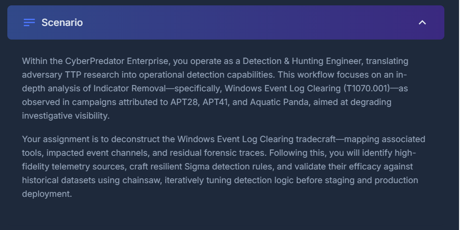

## Technique Research

### Question 1 Process Creation Detection

The native Windows utility `wevtutil.exe` can be used to manage and clear event logs. Monitoring its execution helps identify suspicious log-clearing activity.

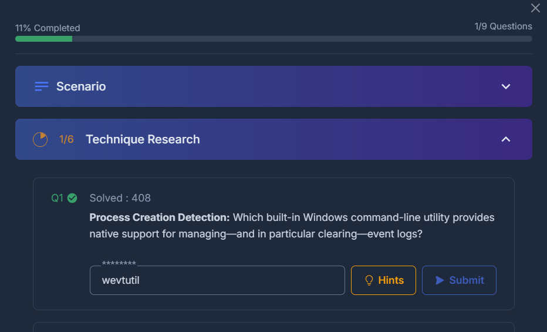


### Question 2 WMI-Based Windows Event Log Clearing Detection

**Objective:** Identify the WMI component associated with clearing Windows event logs and understand how attackers can abuse it to remove security evidence.

**Technical Explanation:**

Windows Management Instrumentation (WMI) is a Microsoft technology that enables administrators to manage and monitor Windows operating systems.

Windows Management Instrumentation Command-line (WMIC) provides command-line access to WMI functionality.

The `nteventlog` WMIC alias maps to the `Win32_NTEventLogFile` WMI class, which provides functionality for managing Windows event logs.

**Example Command:**

```cmd
wmic nteventlog where "LogFileName='Security'" call ClearEventLog
```

This command demonstrates how the Windows Security event log can be cleared using WMI.

**Security Implications:**

Attackers may abuse legitimate Windows management tools to clear event logs, remove evidence of unauthorized activity, and complicate security investigations.

**Detection Engineering Approach:**

Security engineers can monitor Windows process creation events for suspicious commands containing:

- `wmic.exe`
- `nteventlog`
- `ClearEventLog`
- References to Security, System, or Application event logs

**Key Finding:**

WMI-based event log clearing represents an alternative method to using `wevtutil.exe`. Effective detection engineering requires monitoring multiple techniques attackers may use to remove evidence.

**MITRE ATT&CK:** T1070.001 Clear Windows Event Logs (lab classification).

### Screenshot Evidence Question 2

The following screenshot documents the WMI Process Creation Detection investigation conducted during the SigmaPredator lab.

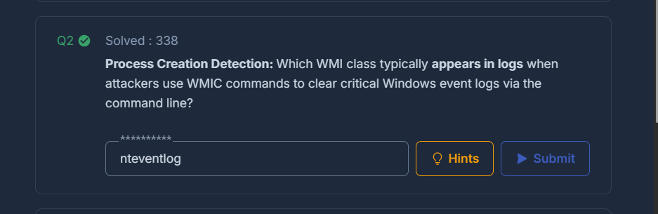

*Figure 2: SigmaPredator Question 2 WMI Process Creation Detection.*


### Question 3 PowerShell Script Block Logging Detection

**Objective:** Identify the PowerShell logging mechanism and Windows Event ID used to monitor suspicious PowerShell execution associated with Windows event log clearing.

**Logging Feature:** PowerShell Script Block Logging

**Windows Event Channel:** `Microsoft-Windows-PowerShell/Operational`

**Event ID:** `4104`

#### Technical Explanation

PowerShell Script Block Logging is a Windows security logging feature that records the content of PowerShell scripts and commands during execution.

When Script Block Logging is enabled, Windows generates Event ID 4104 in the `Microsoft-Windows-PowerShell/Operational` event channel.

This provides security analysts with visibility into PowerShell activity and helps identify suspicious commands that attackers may execute to clear Windows event logs.

#### Example of Suspicious Activity

```powershell
Clear-EventLog -LogName Application
```

This command clears entries from the Windows Application event log.

Although this functionality can be used for legitimate administrative purposes, attackers may abuse it to remove evidence of malicious activity.

#### Detection Engineering Approach

Security engineers can develop Sigma rules to analyze PowerShell Script Block Logging events for suspicious commands associated with event log manipulation.

Relevant indicators include:

- `Clear-EventLog` Clears entries from specified Windows event logs.
- `Remove-EventLog` Deletes specified classic Windows event logs or unregisters event sources.
- `EventLogSession.ClearLog()` A .NET method that can clear Windows event logs.

Monitoring Event ID 4104 allows security teams to identify potentially suspicious PowerShell code and investigate whether the activity was authorized.

#### Security Implications

Attackers may attempt to clear Windows event logs to reduce forensic visibility and conceal unauthorized activities.

PowerShell Script Block Logging provides an additional detection opportunity beyond monitoring process creation events alone.

#### Key Findings

PowerShell Script Block Logging and Event ID 4104 provide important visibility into PowerShell-based event log manipulation.

Detection engineers should combine PowerShell telemetry with process creation events and Windows event log clearing indicators to improve detection coverage and reduce reliance on a single data source.

**MITRE ATT&CK:** T1070.001 Clear Windows Event Logs (classification used in the SigmaPredator lab).

#### Screenshot Evidence

The screenshot below documents Question 3 of the SigmaPredator Detection Engineering investigation.

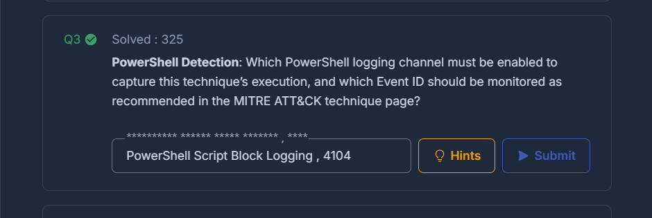

*Figure 3: Investigation of PowerShell Script Block Logging and Windows Event ID 4104 during the SigmaPredator lab.*


### Question 4 PowerShell Cmdlets for Windows Event Log Clearing

**Objective:** Identify built-in PowerShell cmdlets that can be used to clear or remove Windows event logs and understand their significance in cybersecurity detection engineering.

**Identified PowerShell Cmdlets:**
- `Clear-EventLog`
- `Remove-EventLog`

#### Technical Explanation

PowerShell provides legitimate administrative commands for managing Windows event logs. However, attackers can abuse these capabilities to remove evidence of unauthorized activity and interfere with security investigations.

**1. Clear-EventLog**

The `Clear-EventLog` cmdlet clears entries from specified classic Windows event logs without deleting the log itself.

Example:

```powershell
Clear-EventLog -LogName Application
```

This command clears entries from the Windows Application event log.

**2. Remove-EventLog**

The `Remove-EventLog` cmdlet removes specified classic Windows event logs or unregisters event sources, depending on the parameters supplied.

Example:

```powershell
Remove-EventLog -LogName MyCustomLog
```

This command removes a specified custom event log. Unlike `Clear-EventLog`, the purpose is not simply to empty existing entries.

#### Security Implications

Attackers may abuse PowerShell event log management commands to:

- Remove evidence of suspicious activities.
- Reduce the visibility available to security monitoring systems.
- Complicate incident response and forensic investigations.
- Conceal portions of an attacker's activity.

These actions can indicate defense evasion, although authorized administrators may also perform legitimate event log maintenance.

#### Detection Engineering Approach

As a Detection Engineer, I investigated PowerShell commands associated with event log manipulation.

Potential detection indicators include:

- Execution of `Clear-EventLog`.
- Execution of `Remove-EventLog`.
- Suspicious PowerShell script blocks recorded under Event ID 4104.
- Unusual administrative activity involving event log management.

Sigma detection rules can use these indicators to identify potentially malicious PowerShell activity.

#### Key Findings

Both `Clear-EventLog` and `Remove-EventLog` can affect the availability of Windows event log evidence.

Monitoring these commands through PowerShell Script Block Logging, alongside process creation and native Windows event telemetry, can improve detection coverage.

**MITRE ATT&CK:** T1070.001 Clear Windows Event Logs (SigmaPredator lab classification).

#### Screenshot Evidence Question 4

The following screenshot documents the successful identification of the PowerShell cmdlets associated with Windows event log clearing.

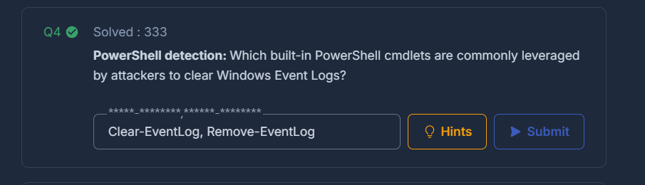

*Figure 4: CyberDefenders SigmaPredator Identification of Clear-EventLog and Remove-EventLog PowerShell cmdlets.*


### Question 5 .NET API Methods for Windows Event Log Clearing

**Objective:** Identify native .NET API methods that can be invoked through PowerShell to clear Windows event logs and understand how to detect their misuse.

**Identified .NET Methods:**
- `EventLogSession.ClearLog`
- `EventLog.Clear`

#### Technical Explanation

The Microsoft .NET framework provides APIs that allow applications and PowerShell scripts to interact with Windows operating system components.

Two important methods associated with Windows event log clearing are:

**1. EventLogSession.ClearLog**

- Namespace: `System.Diagnostics.Eventing.Reader`
- Class: `EventLogSession`
- Method: `ClearLog()`

This method allows a program to clear events from a specified Windows event log.

**2. EventLog.Clear**

- Namespace: `System.Diagnostics`
- Class: `EventLog`
- Method: `Clear()`

This method removes entries from an event log associated with an EventLog object.

#### Security Implications

Attackers may invoke these methods through PowerShell or other .NET applications to remove security evidence and interfere with forensic investigations.

Unlike traditional command-line approaches, .NET-based execution may avoid detection rules focused exclusively on `wevtutil.exe`, WMIC, or specific PowerShell cmdlets.

#### Detection Engineering Approach

Security engineers can monitor PowerShell Script Block Logging events, particularly Event ID 4104, for references to:

- `EventLogSession`
- `ClearLog`
- `System.Diagnostics.EventLog`
- `.Clear()`

Detection logic should correlate these indicators with process activity, user privileges, and relevant Windows log-clearing events to reduce false positives.

#### Key Findings

Windows event logs can be cleared through multiple interfaces, including command-line utilities, PowerShell cmdlets, WMI, and .NET APIs.

Effective detection engineering requires visibility into these different execution methods rather than relying on a single indicator.

**MITRE ATT&CK:** T1070.001 Clear Windows Event Logs (lab classification).

#### Screenshot Evidence Question 5

The following screenshot documents the identification of .NET API methods associated with Windows event log clearing.

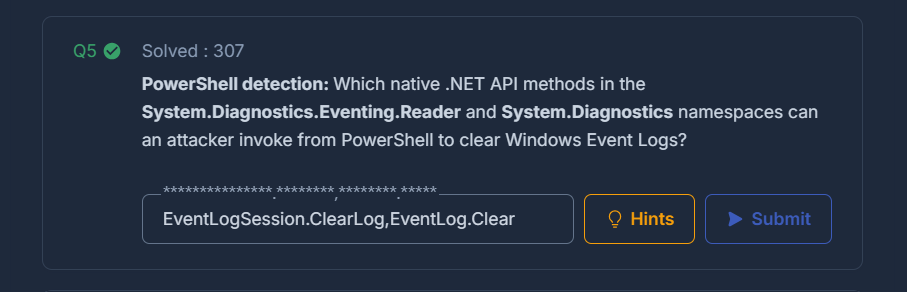

*Figure 5: CyberDefenders SigmaPredator Research into .NET API methods used for Windows event log clearing.*


### Question 6 Windows Event IDs for Event Log Clearing Detection

**Objective:** Identify Windows Event IDs associated with clearing System and Security event logs and explain their importance in detecting potential defense evasion.

**Identified Event IDs:**
- **Event ID 104** Windows event log clearing
- **Event ID 1102** Security audit log clearing

#### Technical Explanation

Windows Event Logs record important operating system activities, including authentication events, application activities, system changes, and security-related operations.

When event logs are cleared, Windows can generate specific event records indicating that a log-clearing operation occurred.

**1. Event ID 104 Event Log Cleared**

- Event provider: Microsoft-Windows-Eventlog
- Commonly recorded in the System event channel
- Indicates that a Windows event log was cleared

This event can provide evidence of event log clearing even after previous entries have been removed.

**2. Event ID 1102 Security Audit Log Cleared**

- Event provider: Microsoft-Windows-Eventlog
- Recorded in the Security event channel
- Indicates that the Windows Security audit log was cleared

This event is particularly important because the Security log contains valuable records of authentication and security-related activities.

#### Security Implications

Attackers may clear Windows event logs to hide unauthorized access, malicious commands, or other suspicious activity.

Monitoring Events 104 and 1102 helps security teams identify potential attempts to remove investigative evidence.

However, log clearing can also occur during legitimate administrative maintenance. Analysts must evaluate the context before concluding that an attack occurred.

#### Detection Engineering Approach

As a Detection Engineer, I identified the following monitoring opportunities:

- Monitor Event ID 104 for Windows event log clearing activity.
- Monitor Event ID 1102 for Security audit log clearing.
- Correlate these events with suspicious PowerShell commands, WMIC activity, and `wevtutil.exe` execution.
- Investigate the associated user account, affected system, timestamp, and related process activity.

Sigma detection rules can use these Windows event records to generate alerts for potentially suspicious log-clearing behavior.

#### Key Findings

Event IDs 104 and 1102 provide important evidence of Windows event log clearing.

Combining native Windows event log telemetry with PowerShell Script Block Logging and process creation monitoring can improve detection coverage.

**MITRE ATT&CK:** T1070.001 Clear Windows Event Logs (lab classification; subsequently T1685.005).

#### Screenshot Evidence Question 6

The following screenshot documents the identification of Windows Event IDs associated with event log clearing.

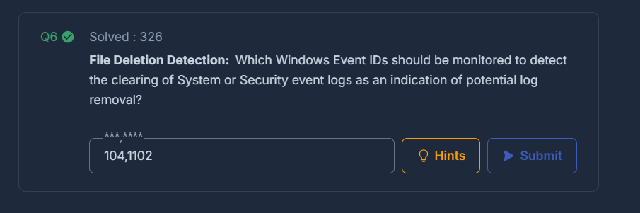

*Figure 6: CyberDefenders SigmaPredator Identification of Windows Event IDs 104 and 1102 for log clearing detection.*


## Phase 2 Sigma Rule Development and Validation

### Question 7 PowerShell Event Log Clearing Detection Using Sigma and Chainsaw

**Objective:** Develop, validate, and execute a Sigma detection rule to identify suspicious PowerShell-based Windows event log clearing activity and determine the earliest matching event timestamp from historical Windows event logs.

### 1. Investigation Environment and Historical Logs

The investigation was conducted in the CyberDefenders SigmaPredator virtual machine using Chainsaw, Sigma, and Windows Event Log (EVTX) files.

The provided historical dataset contained **333 EVTX files**, which were examined to identify suspicious PowerShell activity associated with event log clearing.

**Tools Used:**
- Chainsaw Windows event log analysis and detection validation.
- Sigma Detection rule development.
- PowerShell Command execution and analysis.
- Windows EVTX Logs Historical security event evidence.
- MITRE ATT&CK Adversary technique reference.

**Historical Log Location:**

`Start Here/Historical Logs`

#### Screenshot 08 Historical Windows Event Logs

The screenshot below shows the historical EVTX dataset used for the investigation.

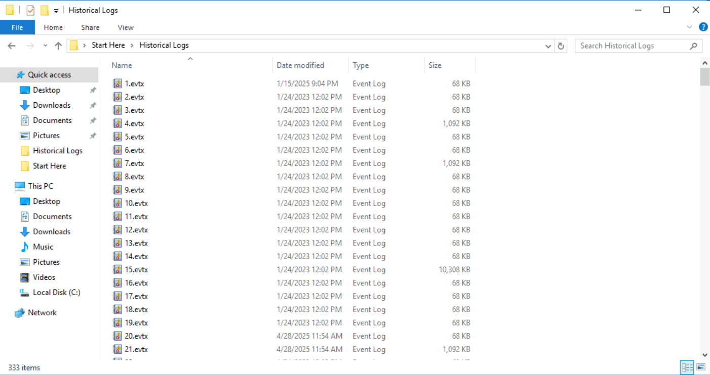

*Figure 8: Historical Windows EVTX files provided in the SigmaPredator laboratory environment.*

---

### 2. Sigma Detection Rule Development

The objective was to identify suspicious PowerShell commands used to clear Windows event logs.

The detection focused on two PowerShell cmdlets:

- `Clear-EventLog`
- `Remove-EventLog`

Because the lab specified that PowerShell was operating in Constrained Language Mode, .NET-based detection methods were excluded from this rule.

**Sigma Rule Filename:** `powershell-event-log-clearing.yml`

**Sigma Detection Rule:**

```yaml
title: Suspicious PowerShell Event Log Clearing
status: experimental
description: Detects PowerShell cmdlets associated with clearing Windows event logs.
author: SigmaPredator Lab

logsource:
  product: windows
  category: ps_script

detection:
  selection:
    ScriptBlockText|contains:
      - 'Clear-EventLog'
      - 'Remove-EventLog'
  condition: selection

falsepositives:
  - Authorized administrative event log maintenance

level: high
```

**Detection Logic Explanation:**

- `title` identifies the detection rule.
- `logsource` specifies Windows PowerShell script block telemetry.
- `ScriptBlockText` represents the PowerShell script content to inspect.
- `contains` searches for either specified event log management cmdlet.
- `condition: selection` requires the selection criteria to match.
- `level: high` assigns a high severity to the detection.

The rule is intended to detect potentially suspicious event log clearing commands, but matching activity requires further investigation to establish whether it was malicious.

---

### 3. Sigma Rule Validation Using Chainsaw

Before testing the rule against the historical dataset, Chainsaw was used to validate the Sigma rule structure.

**Validation Command:**

```powershell
.\chainsaw.exe lint --kind sigma .\sigma-rules\
```

**Validation Output:**

```text
[+] Validating as sigma for supplied detection rules...
[+] Validated 1 detection rules out of 1
```

The validation confirmed that Chainsaw successfully parsed the Sigma rule without reporting structural errors.

#### Screenshot 09 Successful Sigma Rule Validation

The screenshot below demonstrates successful rule validation through Chainsaw.

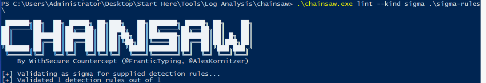

*Figure 9: Chainsaw successfully validated the PowerShell event log clearing Sigma detection rule.*

---

### 4. Historical EVTX Analysis Using Chainsaw

After validating the rule, Chainsaw was executed against the historical Windows Event Log dataset.

**Chainsaw Hunt Command:**

```powershell
.\chainsaw.exe hunt "..\..\..\Historical Logs" -s ".\sigma-rules" --mapping ".\mappings\sigma-event-logs-all.yml"
```

**Command Explanation:**

- `hunt` searches the historical Windows event logs for suspicious activity.
- `..\..\..\Historical Logs` specifies the directory containing the EVTX dataset.
- `-s` specifies the custom Sigma rule directory.
- `--mapping` specifies the Sigma field-mapping configuration.

Chainsaw scanned the **333 historical EVTX files** and identified one event matching the custom detection rule.

#### Investigation Results

| Attribute | Result |
|---|---|
| Analysis Tool | Chainsaw |
| Detection Rule | Suspicious PowerShell Event Log Clearing |
| Historical EVTX Files | 333 |
| Matching Detections | 1 |
| Event Provider | Microsoft-Windows-PowerShell |
| Event ID | 4104 |
| Event Record ID | 4460 |
| Suspicious Command | `Clear-EventLog -LogName application, system -confirm` |
| Earliest Matching Timestamp | `2021-10-25 18:04:24` |

**Technical Finding:**

Chainsaw identified a PowerShell script block containing the `Clear-EventLog` cmdlet.

The command targeted the Windows Application and System event logs and therefore represented potential event log clearing activity.

This detection illustrates how PowerShell Script Block Logging can help security analysts identify potentially suspicious administrative commands.

#### Screenshot 10 Chainsaw Detection Results

The screenshot below shows the actual Chainsaw detection output, including the matching event and its timestamp.

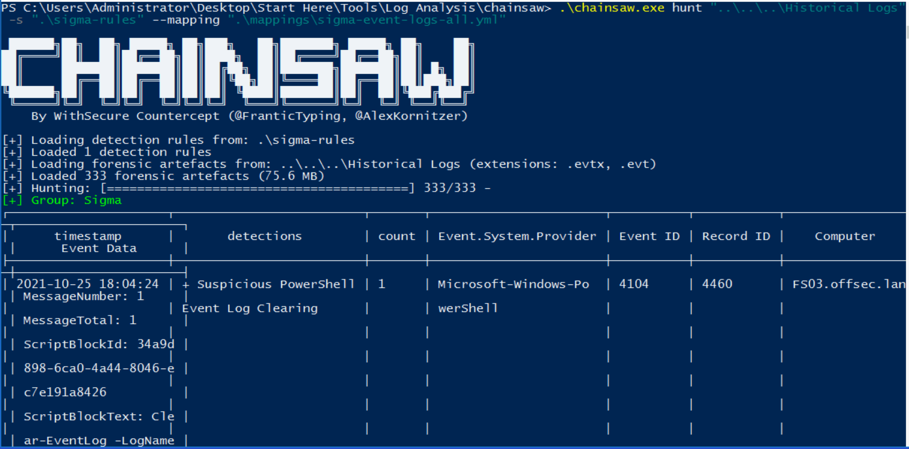

*Figure 10: Chainsaw identified a matching PowerShell event log clearing command in the historical EVTX dataset.*

---

### 5. Earliest Detection Timestamp and Lab Verification

Question 7 required identifying the timestamp of the earliest event detected by the custom Sigma rule.

The Chainsaw investigation identified one matching event.

**Earliest Detection Timestamp:** `2021-10-25 18:04:24`

The timestamp was formatted according to the CyberDefenders question requirements.

**Submitted and Accepted Answer:**

`2021-10-25 18:04`

CyberDefenders accepted the submitted timestamp, confirming successful completion of Question 7.

#### Screenshot 11 CyberDefenders Accepted Answer

The screenshot below documents the accepted response for Question 7.

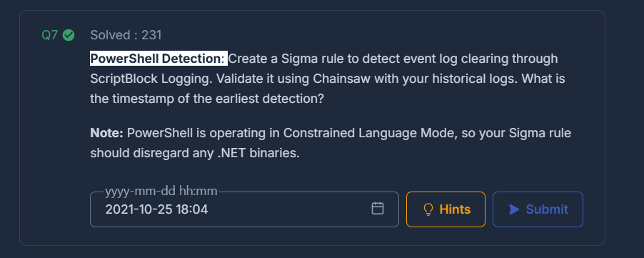

*Figure 11: CyberDefenders confirmation of the accepted earliest detection timestamp for Question 7.*

---

### 6. Detection Engineering Findings

The investigation demonstrated how Sigma detection rules can be developed and validated against historical Windows event logs.

**Key Findings:**

1. PowerShell Script Block Logging provides useful visibility into event log clearing commands.
2. Sigma rules can detect suspicious PowerShell activity by inspecting script block content.
3. Chainsaw successfully validated the custom detection rule.
4. Analysis of 333 historical EVTX files produced one matching event.
5. The suspicious activity was associated with Windows Event ID 4104.
6. The earliest matching event timestamp was identified and successfully submitted to CyberDefenders.

**Detection Limitations:**

The custom rule focuses on `Clear-EventLog` and `Remove-EventLog`. It does not cover every possible event log clearing method.

Additionally, an event matching the rule is not automatically proof of malicious activity. Authorized administrative maintenance could produce similar results.

---

### 7. Security Recommendations

Based on the investigation, organizations should consider implementing the following security practices:

- Enable PowerShell Script Block Logging on applicable Windows systems.
- Monitor suspicious use of `Clear-EventLog` and `Remove-EventLog`.
- Forward security logs to a centralized SIEM platform.
- Monitor Windows Event IDs 104 and 1102 for event log clearing.
- Correlate PowerShell activity with process creation and administrative account activity.
- Investigate unexpected event log clearing on critical systems.
- Apply least-privilege access controls to reduce unauthorized administrative activity.

---

### 8. Skills Demonstrated

This investigation provided practical experience in:

- Detection Engineering
- Sigma Rule Development
- Chainsaw Threat Hunting
- PowerShell Script Block Logging
- Windows Event Log Analysis
- Security Event Correlation
- MITRE ATT&CK Technique Research
- Detection Validation and Documentation

**MITRE ATT&CK:** T1070.001 Clear Windows Event Logs (identifier used by the SigmaPredator lab).

**Question 7 Status:** Completed Answer accepted by CyberDefenders.
